  
  

    
    
    
  

 

<h3><code>pedro@github:~$ neofetch</code></h3>

  

 

<h3><code>pedro@github:~$ cat focus.md</code></h3>

Software engineer focused on backend architecture, SaaS infrastructure, and AI tooling.

- **Now:** building **[Émile CLI](https://github.com/heyalmeida/emile-cli)** — a provider-agnostic terminal coding agent with a skills system, MCP integration, and plans mode.
- **Also:** building **[Luarvia](https://dash.luarvia.dev)** — a managed deployment platform for agencies and freelance developers, with teams, projects, and resource pools.
- **Focus:** AI-powered developer tooling, multi-tenant systems, and web performance.
- **Workflow:** spec-driven development with AI engineering tools (Claude Code, Cursor) to keep output high without trading away code quality.

 

<h3><code>pedro@github:~$ git log --stat</code></h3>

| Project | Description | Stack |
| :--- | :--- | :--- |
| **[Émile CLI](https://github.com/heyalmeida/emile-cli)** | Provider-agnostic terminal coding agent — skills system, MCP via STDIO, session persistence, plans mode and live reasoning stream | Node.js, ES Modules, YAML, MCP |
| **Lumine** | Multi-provider LLM chatbot platform with real-time streaming responses | Next.js 15, Hono, Redis, MongoDB, Vercel AI SDK |
| **[Luarvia](https://dash.luarvia.dev)** | Self-hosted CI/CD and deployment platform with automated reverse-proxy and Cloudflare tunnel integration | Go, Docker, Nginx, Stripe API, MySQL |
| **Lojas M&M** | E-commerce platform with integrated Mercado Pago checkout and automated shipping calculations | Next.js, React, Mercado Pago API, Correios API |
| **[Studia](https://github.com/heyalmeida/studia-app/tree/main)** | Academic study organizer for managing subjects, study tasks, exams, schedules and academic progress | React Native, Expo, TypeScript |

 

<h3><code>pedro@github:~$ ./contributions.sh</code></h3>

  

 

  <code>heyalmeida</code> — clean architecture &amp; minimal design.
   
  One day, one building. Height reflects contributions; quiet days stay at ground level. Generated in-repo and refreshed daily via GitHub Actions.

